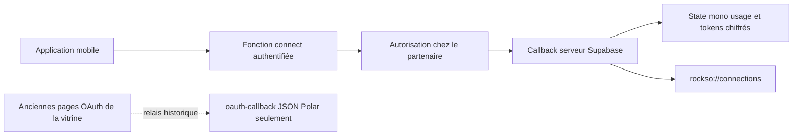
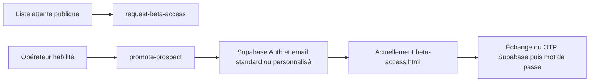
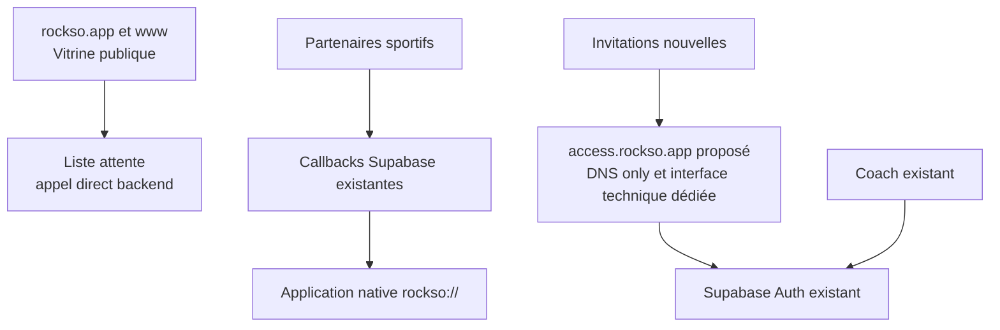

# Séparer la vitrine Rockso des parcours sensibles

**26 novembre 2026, America/Toronto — audit réceptionné ; séparation minimale validée comme architecture cible, aucune mise en œuvre autorisée.**

Publication documentaire ultérieure : ce texte conserve les constats et estimations de l’audit reçu. Les mentions d’absence de changement de dépôt/PR décrivent sa réalisation initiale. La publication présente ajoute seulement la documentation ; l’[arbitrage P0](ARBITRAGE_P0_2026_11_26.md) distingue désormais la sécurité temporaire des dettes de séparation.

**Recommandation : séparer les interfaces publiques et techniques, en conservant les callbacks Supabase existants.** La priorité est de sortir l’activation bêta de `rockso.app`, de vérifier les URL réellement enregistrées chez les partenaires et de retirer de la publication les démos historiques après confirmation de leurs usages. Déplacer tous les callbacks vers un nouveau domaine apporterait surtout des changements de configuration et des risques supplémentaires.

Le fondateur a précisé que l’objectif est **d’éviter le proxy HTTP configuré dans la zone Rockso**, et de qualifier séparément les fournisseurs. L’architecture proposée ne promet donc pas une chaîne sans Cloudflare : l’endpoint Supabase répond déjà avec `server: cloudflare`, et la [liste officielle Supabase du 12 octobre 2026](https://supabase.com/legal/subprocessor-list/October-12-2026.pdf) mentionne Cloudflare pour l’hébergement et le CDN. Cette chaîne fournisseur reste à qualifier.

## 1. Sources et niveau de preuve

- Vitrine : [App_Prototype, 74ad7df0](https://github.com/EGRockso/App_Prototype/tree/74ad7df0a1a309e1ce4653a1ab8601ecde00fe39), même base que la [PR documentaire #1](https://github.com/EGRockso/App_Prototype/pull/1), toujours brouillon lors de la lecture.
- Applications : [main Mobile/Coach, 6bbe2138](https://github.com/EGRockso/Rockso_Mobile_Prototype/tree/6bbe213801504f0b7ca93d4bc7f5e14037a25cf2). Le checkout local `d03a5201` est plus ancien ; les fichiers actuels de connexion et d’authentification ont été relus à distance. La branche distante `codex/travail-en-cours` était `4350749d`. Aucun de ces états n’est assimilé au binaire effectivement installé.
- Backend : neuf fonctions pertinentes téléchargées en lecture seule depuis le projet `hegtnyarfeoyapobysee`, avec leur version et empreinte de bundle. Leurs neuf entrypoints correspondent octet par octet au commit `d03a5201`, mais six diffèrent du `main` actuel. Cette correspondance ne certifie pas tous les modules partagés des bundles. Aucun démarrage OAuth, invitation, connexion réelle, écriture SQL ou appel de callback n’a été exécuté.
- Usage : liens et contrats de code vérifiés ; les recherches agrégées dans les journaux de fonctions sur leur fenêtre disponible par défaut de 24 heures n’ont trouvé aucune invocation des neuf fonctions ciblées. Ce résultat limité ne démontre ni leur abandon, ni une absence de trafic des pages GitHub Pages.
- Partenaires : documentation publique et dossiers Rockso consultés ; **aucun portail partenaire ni valeur des variables serveur n’a été lu**. Les URL actuellement enregistrées doivent encore être rapprochées du code. Les configurations Auth et les modèles d’e-mails hébergés restent également à vérifier. Le site Coach servi et le binaire natif n’ont pas été recettés dans cet audit.

Le vocabulaire distingue **parcours raccordé**, **capacité déployée**, **usage récent observé** et **usage non démontré**. La présence d’un fichier ou l’absence d’événement sur 24 heures ne suffit pas à classer une page supprimable.

## 2. Pages actives et candidates au retrait

| Ensemble | Constat vérifié | Classement et proposition |
| --- | --- | --- |
| `demo-login.html`, `demo-login-en.html` | Sept liens de CTA par accueil FR/EN. Formulaire e-mail, rôle/organisation facultatifs ; POST direct à `request-beta-access`, déployée v88 | **Fonction marketing raccordée à conserver.** Ces pages ne sont pas des écrans de connexion. Elles peuvent rester sur la vitrine ; un renommage est facultatif, pas un prérequis |
| `beta-access.html` | Page de validation d’invitation et définition du mot de passe. `promote-prospect` déployée v37 conserve cette URL par défaut et peut fabriquer un lien comportant `token_hash` en query | **Dépendance opérationnelle à préserver et déplacer.** Le défaut peut être remplacé par le corps de la commande ou `PROSPECT_INVITE_REDIRECT_TO` ; leur valeur effective n’est pas démontrée |
| `/oauth/polar/callback/` | Page relais POSTant au callback générique ; celui-ci déployé v98 ne traite que `provider=polar` | **Compatibilité historique possible.** Ne pas supprimer tant que le portail Polar, `POLAR_REDIRECT_URI` et les émetteurs de liens ne sont pas rapprochés |
| `/oauth/suunto/callback/`, `/oauth/coros/callback/`, `/oauth/garmin/callback/` | Relais vers le même callback générique, qui refuse ces fournisseurs. Aucun lien entrant identifié dans les parcours applicatifs inspectés | **Candidates fortes au retrait de publication**, mais pas déclarées inutilisées chez les partenaires. Si une de ces URL reste enregistrée, c’est une dépendance à corriger avant retrait |
| `demo-app.html` et `app-demo/**` | Iframe d’un ancien export Expo ; aucun lien depuis les accueils actuels. Le README décrit encore un lien marketing qui n’existe plus. Le bundle contient des capacités Supabase/Sentry | **Démonstrateur historique candidat au retrait**, après validation de l’usage commercial/opérateur et des liens diffusés. Ne pas le qualifier de démo entièrement fictive ou isolée sans recette |
| `demo/**` — neuf pages HTML et ressources associées | Ancienne démo avec vérification de session Supabase puis renvoi vers `demo-login.html`, qui est désormais une liste d’attente. Aucun lien entrant depuis les accueils actuels | **Parcours historique candidat au retrait**, sans remplacement automatique ; confirmer les favoris, présentations et usages opérateur |
| `index-old.html`, `index-en-old.html` | Anciennes versions, hors liens des accueils courants | Candidates au retrait de publication après contrôle des liens externes ; conserver leur historique Git |
| `/login`, `/signup`, `/forgot-password`, `/reset-password` | Routes réelles du site Coach ; aucun HTML équivalent dans la racine de la vitrine. Le helper Mobile Web conserve cependant `APP_URL` par défaut vers `https://rockso.app` | **Coach reste distinct.** La valeur de build Web est une dépendance latente à éliminer ou confirmer avant de déclarer la racine débarrassée de tout retour Auth |
| Pages légales, suppression de compte et ressources de marque | Information publique nécessaire ; suppression renvoie vers Coach. Logos Garmin publics ajoutés en novembre | À conserver sur la vitrine si utilisés. Un logo ou une politique publique pour un partenaire n’est pas un callback sensible |

Aucune suppression n’est effectuée. « Retrait » signifie ici une future sortie du contenu publié, avec archives Git conservées ; pas la destruction des sources ou des historiques.

## 3. Dépendances des applications et du backend

### OAuth sportif

| Fournisseur | Contrat actuel vérifié | Conséquence d’une séparation minimale |
| --- | --- | --- |
| Suunto | `integrationsService.connectSuunto` → `suunto-oauth-connect` v41 ; URI lue dans `SUUNTO_REDIRECT_URI`. Callback dédié v142, retour `rockso://connections`. Guide Rockso mentionne déjà l’URL Supabase directe | Aucun changement partenaire ou natif attendu **si** cette URI directe est bien celle configurée. Le webhook Suunto est distinct et ne doit pas être déplacé avec la page relais |
| Polar | Fonction connect v33 ; URI `POLAR_REDIRECT_URI`. Callback dédié v96 et callback JSON historique v98. Retour du callback dédié dans l’app | Vérifier laquelle des deux chaînes est réellement utilisée. Si le relais vitrine reste la cible, migration coordonnée autorisation/échange de code/portail indispensable |
| COROS | Fonctions connect v20/callback v21, état mono-usage et PKCE, configuration `COROS_REDIRECT_URI`, flag et liste de comptes autorisés. Retour `rockso://connections` | Préserver la callback existante. L’outil d’enregistrement Rockso **refuse un domaine personnalisé** : il n’accepte que `https://<20 caractères>.supabase.co/functions/v1/coros-oauth-callback`. Tout autre hôte demanderait aussi une adaptation de cet outil et du client enregistré |
| Garmin | Stub Mobile désactivé, fonctions Garmin absentes de la liste déployée. [#81](https://github.com/EGRockso/Rockso_Mobile_Prototype/issues/81) rapporte un callback enregistré directement sur Supabase ; [PR #82](https://github.com/EGRockso/Rockso_Mobile_Prototype/pull/82) contient un candidat serveur non reçu comme déployé | Ne pas réintroduire l’ancienne page vitrine. Préserver l’URL enregistrée dans la préparation Garmin ; ne pas confondre cette page avec un parcours actif ni avec un webhook Activity |
| Strava | Stub et service présentés indisponibles dans la source inspectée ; pas de fonction correspondante dans l’inventaire déployé | Aucun parcours Strava actif à migrer n’est démontré ; ne pas en inventer un pour ce lot |

Les fonctions dédiées téléchargées contrôlent le propriétaire par état consommé et les barrières de compte ; elles conservent le stockage chiffré serveur. **Le `main` actuel n’est pas une base de redéploiement équivalente** : les différences observées touchent notamment `integrationLifecycle` et l’autorisation administrative de `promote-prospect`. Repartir des sources et modules effectivement déployés, rapprochés d’une référence acceptée ; ne pas écraser ces protections lors d’un changement d’URL. Une migration d’hôte ne doit pas remplacer ces protections par un simple relais JavaScript ou un `redirectTo` libre.

Sources applicatives : [service de connexions](https://github.com/EGRockso/Rockso_Mobile_Prototype/blob/6bbe213801504f0b7ca93d4bc7f5e14037a25cf2/lib/services/integrationsService.ts), [COROS](https://github.com/EGRockso/Rockso_Mobile_Prototype/blob/6bbe213801504f0b7ca93d4bc7f5e14037a25cf2/lib/services/integrations/corosService.ts), [contrat d’enregistrement COROS](https://github.com/EGRockso/Rockso_Mobile_Prototype/blob/6bbe213801504f0b7ca93d4bc7f5e14037a25cf2/scripts/integrations/coros-mcp/registration.ts).

### Invitation bêta et authentification

Les dépendances à revoir lors d’un futur déplacement sont : priorité de `payload.redirectTo`, variable `PROSPECT_INVITE_REDIRECT_TO`, défaut codé et normalisation des anciennes cibles ; mode standard/custom des e-mails ; modèles Supabase/Resend et URL autorisées Auth ; éventuelles commandes opérateur déjà enregistrées. Le code déployé peut ajouter `token_hash` à l’URL personnalisée. Le producteur normalise aussi les anciennes cibles `https://rockso.app/beta/welcome?source=beta-invite` et `rockso://verify-email` vers son défaut bêta. Les anciens e-mails et invitations non expirées sont donc une dépendance de transition, même après changement du défaut.

`beta-access.html` utilise Supabase pour échanger un code, vérifier un OTP ou établir une session puis changer le mot de passe. Les fragments ne transitent pas dans la requête initiale ; les paramètres de query, eux, transitent. Le passage à une nouvelle origine modifie les stockages navigateur : ne pas copier des tokens ou supposer le partage d’un vérificateur PKCE entre origines. Examiner aussi la consommation du lien par un scanner d’e-mail.

Le natif utilise le schéma `rockso://`, pas une page `rockso.app/login`. Si ces contrats restent identiques, aucun rebuild natif ne découle mécaniquement du déplacement de la page bêta ; cela reste à vérifier sur le binaire reçu. Coach conserve ses propres routes et retours de récupération basés sur `window.location.origin` ; ce n’est pas une autorisation de modifier Coach.

Sources : [page bêta](https://github.com/EGRockso/App_Prototype/blob/74ad7df0a1a309e1ce4653a1ab8601ecde00fe39/beta-access.html), [promote-prospect](https://github.com/EGRockso/Rockso_Mobile_Prototype/blob/d03a5201a9146b5fb8b2c2c1fbcbd64ed5a3820c/supabase/functions/promote-prospect/index.ts), [helper Auth](https://github.com/EGRockso/Rockso_Mobile_Prototype/blob/6bbe213801504f0b7ca93d4bc7f5e14037a25cf2/lib/utils/authLinks.ts), [récupération Coach](https://github.com/EGRockso/Rockso_Mobile_Prototype/blob/6bbe213801504f0b7ca93d4bc7f5e14037a25cf2/web/src/pages/PasswordRecoveryPage.tsx).

## 4. Configurations partenaires à confirmer

| Configuration | Lecture nécessaire avant retrait ou migration | Risque si changée sans coordination |
| --- | --- | --- |
| Suunto ApiZone, profil OAuth/application | Callback exacte, réglage d’application et webhook séparé ; rapprocher `SUUNTO_REDIRECT_URI` | Code envoyé au mauvais endpoint ou échec d’échange. La [FAQ officielle](https://apizone.suunto.com/faq) situe ces réglages dans le profil |
| Polar AccessLink Admin | Liste des URL et défaut, puis correspondance à `POLAR_REDIRECT_URI` et à l’URI d’échange | La [documentation Polar](https://www.polar.com/accesslink-api/) permet plusieurs URI et refuse une URI non enregistrée. Ne pas retirer l’ancienne avant validation de la nouvelle chaîne |
| COROS, enregistrement du client régional | Extraire seulement `redirect_uris` et région depuis le reçu privé d’enregistrement ; pas de secret ni de fichier intégral dans le rapport | Créer un autre client peut demander une nouvelle autorisation utilisateur. Ne pas supposer que les tokens existants deviennent automatiquement ceux du nouveau client |
| Garmin Business Starter | Confirmer la callback rapportée dans #81 ; distinguer URL du site, politique, logos et future URL de notification | Le nouveau chantier Garmin dépend d’une callback déjà prévue. Changer de domaine maintenant ajouterait une coordination sans bénéfice démontré |
| Supabase Auth | Site URL, allowlist des redirections, modèles invitation/confirmation/récupération et cibles réellement émises | Retour silencieux à une URL par défaut, lien expiré ou ouverture du mauvais espace. [Référence officielle](https://supabase.com/docs/guides/auth/redirect-urls) |

Ces pièces sont manquantes, pas à modifier pendant cet audit. Relever uniquement hôte/chemin et paramètres statiques non secrets, sans copier un code ou un lien d’invitation réel. Aucune connexion partenaire n’est lancée pour « découvrir » l’URI, car les fonctions connect créent un état serveur.

## 5. Architecture cible proposée

Sur la racine resteraient : accueils FR/EN, informations produit, contact et liste d’attente, pages légales et exercice des droits, ressources publiques nécessaires dont logos partenaires. Aucun export d’application, écran de mot de passe, invitation ou relais OAuth n’y serait intentionnellement publié. Le formulaire de liste d’attente transmet aujourd’hui ses valeurs directement à Supabase ; celles-ci ne deviennent pas automatiquement le corps d’une requête au proxy de la vitrine.

`access.rockso.app` est un **nom proposé**, dont disponibilité, hébergement et certificat restent à vérifier. Il servirait une petite interface d’activation indépendante du produit Coach, avec ses ressources critiques sur la même origine, aucun Analytics, aucun cookie de domaine partagé, contrôles de cache, de référent et de contenu adaptés. Les appels continueraient vers Supabase. Le DNS serait géré chez Cloudflare en DNS only ; cela n’exclut pas les fournisseurs déjà présents.

L’hébergement de cette interface doit être compatible avec une interface d’authentification et permettre les contrôles nécessaires. **GitHub Pages n’est pas retenu par défaut pour la page de mot de passe**, sa [documentation le déconseillant pour les transactions sensibles](https://docs.github.com/en/pages/getting-started-with-github-pages/github-pages-limits). L’authentification générale, les rôles, données et API ne sont pas reconstruits.

## 6. Comparaison des options

| Option | Sécurité et confidentialité | Maintenabilité et régressions | Coût et effort estimés |
| --- | --- | --- | --- |
| Architecture actuelle, DNS only conservé | Pas de nouveau proxy zone ; mélange de contenus publics et parcours sensibles, problèmes historiques conservés | Aucun changement immédiat ; qualification actuelle et hébergement des transactions sensibles restent à traiter | Pas de surcoût d’architecture ; ne réalise pas l’objectif de séparation |
| Proxy zone sur architecture actuelle | Un même intermédiaire reçoit aussi les anciennes URL OAuth/bêta ; périmètre juridique large | Mise en route simple mais couplage marketing/auth et règles plus difficiles à suivre | Cloudflare Free sans surcoût d’abonnement ; coût de qualification et de risque, pas de GO acquis |
| **Callbacks existantes + interface access dédiée** | Retire les parcours sensibles connus de la vitrine ; fournisseur backend toujours qualifié séparément | Frontière claire, un petit frontend supplémentaire ; faible changement OAuth si les URI directes sont confirmées | **3–7 jours-personne** si pas de migration partenaire complexe. Callbacks : aucun nouveau coût fixe. Frontend : devis à obtenir ; enveloppe de cadrage proposée ≤10 €/mois, non tarif vérifié |
| Réutiliser les routes d’authentification Coach | Évite le proxy de zone mais hébergement Coach Cloudflare Pages conservé ; ne réduit pas autant le rôle direct de Cloudflare | Moins d’hébergement, mais risque de confusion Athlète/Coach, admission, invitations et release partagée | Pas de nouvel abonnement à prévoir sous réserve des quotas ; 2–5 jours-personne pour adaptation et recette. Alternative, pas recommandation principale |
| Tout déplacer vers un domaine Supabase personnalisé | Pas de proxy zone requis ; même chaîne fournisseur, domaine API cohérent | Changement large des callback/allowlists ; COROS incompatible avec l’outil actuel. Ce n’est pas un hébergement frontend recommandé par Supabase | Add-on vérifié **10 USD/mois**, plan payant requis, hors coûts existants ; 5–10 jours-personne + délais partenaires non estimables |

Les jours-personne sont des estimations d’ingénierie, pas une mesure ni un calendrier engagé ; ils incluent adaptation ciblée et recette, excluent attente du fondateur/partenaires, conseil juridique et distribution éventuelle. Les options ne s’additionnent pas. La frontière technique dédiée représente environ 0,5–1 jour de rapprochement des configurations, 1–2 jours d’interface/hébergement, 0,5–1 jour de cibles d’invitation/documentation et 1–3 jours de transition/recette.

Supabase indique que ses domaines personnalisés sont destinés aux API et **pas à l’hébergement d’applications frontend** ; leur activation peut aussi modifier les callbacks Supabase Auth annoncées aux fournisseurs. [Domaines personnalisés](https://supabase.com/docs/guides/platform/custom-domains). Les fonctions sans domaine personnalisé réécrivent normalement le HTML en texte brut : un endpoint existant n’est donc pas un remplacement immédiat d’une page interactive. [Limites Edge Functions](https://supabase.com/docs/guides/functions/limits). Le prix de l’add-on est de [0,0137 USD/heure, environ 10 USD/mois](https://supabase.com/docs/guides/platform/manage-your-usage/custom-domains).

## 7. Transition proposée et conditions de non-régression

1. **Fermer l’inventaire des émetteurs.** Lire les configurations ci-dessus et confirmer l’usage des démos auprès du fondateur. Préserver les URL de marque et de documents publics dont dépendent les partenaires. Une page sans lien entrant n’est pas supprimée à ce stade.
2. **Préparer l’interface technique séparée**, son hébergement et ses contrats de données, sans déployer avant un mandat de réalisation distinct. Garder callbacks, base, states, chiffrement, webhook et schéma natif actuels.
3. **Préparer la bascule des invitations.** Couvrir les chemins standard/custom, corps opérateur, variables, constantes, modèles et allowlist Auth. Établir la validité maximale des anciens liens et un protocole de réémission ; ne pas envoyer de nouvelles invitations dans cet audit.
4. **Retirer les pages historiques du contenu publié**, après confirmation de leurs dépendances. Adapter les ressources/liens utiles ; conserver leur historique. Si la liste d’attente est renommée, modifier ensemble CTA, modules acquisition/Analytics, allowlists et tests : ce renommage n’est pas nécessaire à la séparation.
5. **Recetter sur un environnement autorisé** : invitation valide/expirée/réutilisée, navigateur sans session, récupération de mot de passe, différence d’origine/PKCE, retour natif, refus/annulation OAuth, rejouage de state, absence de logs sensibles, consentement PostHog inchangé et absence d’instrumentation technique. Les tests actuels ne sont pas réputés passer sur le futur hébergement.
6. **Conclure la réception et seulement ensuite reprendre la qualification du proxy sur la nouvelle surface**. Réactivation du proxy, publication, changements partenaires et éventuel build font chacun l’objet du GO applicable.

**Point de transition critique :** rediriger une ancienne URL `rockso.app/beta-access.html?...` vers le nouveau domaine ne retire pas le premier passage de son jeton par le proxy de la racine. Un 404, une suppression du HTML, une règle de cache ou un nettoyage JavaScript ne le retire pas non plus. Tant que des anciennes invitations ou callbacks sont émises/utilisables, garder la racine en DNS only selon le STOP reçu, ou accepter explicitement et qualifier cette exposition ; ne pas annoncer une séparation achevée par une simple redirection.

La séparation réduit les parcours sensibles intentionnels, pas toute possibilité de recevoir une query arbitraire contenant des données personnelles sur un site public. Les IP et métadonnées techniques du trafic public restent également à traiter. Les réserves contractuelles et d’information de la PR #1 ne disparaissent donc pas ; leur périmètre pourra être resserré. L’exclusion du test temporaire du 26 novembre et l’interdiction d’intégrer le KPI à Growth restent inchangées.

## 8. Résultat du contrôle et limites

Le contrôle Science/UX/existant et Focus a été relu. Acquis préservés : contrats Auth et intégrations, états mono-usage, droits/générations, consentements et séparation des espaces. Aucun calcul scientifique ou écran n’est modifié. Les six axes sont couverts par conservation des parcours utiles, qualification des données et inconnues, absence de nouveau benchmark visuel nécessaire, retrait conditionnel des doublons, non-applicabilité des calculs sportifs et cohérence entre invitation, backend et destination native.

La chaîne source → endpoint → donnée → exposition → action proposée est documentée sans valider les réglages partenaires ou un binaire non recetté. Les pièces restantes sont les configurations des partenaires/Auth/invitations, l’usage opérateur des démos et le choix d’un hébergement compatible. Il n’existe **aucune suppression définitivement validée ni migration exécutée** à l’issue de cet audit.

Le rapport et son manifeste ont été préparés dans un dossier temporaire ; aucun dépôt, PR, DNS, partenaire, consentement, fonction ou donnée métier n’a été modifié. Les lectures réseau peuvent naturellement produire des journaux d’accès techniques.
